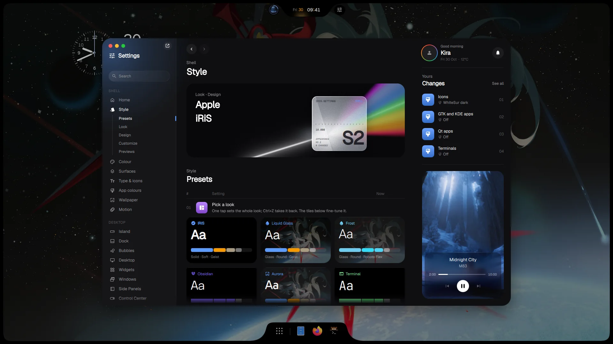
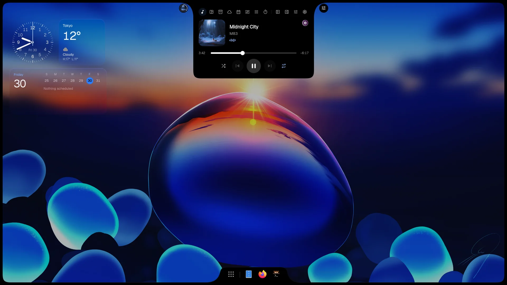
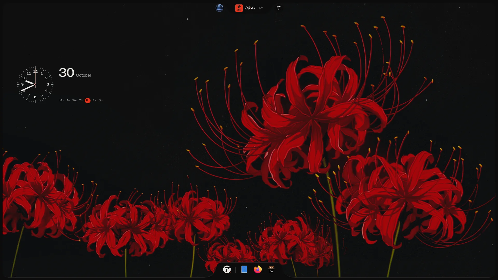
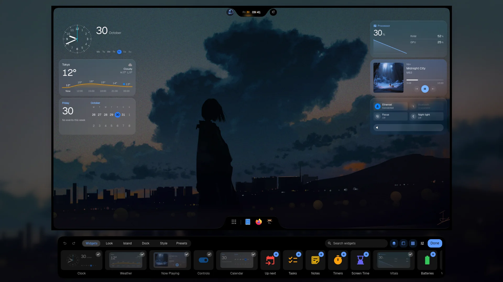
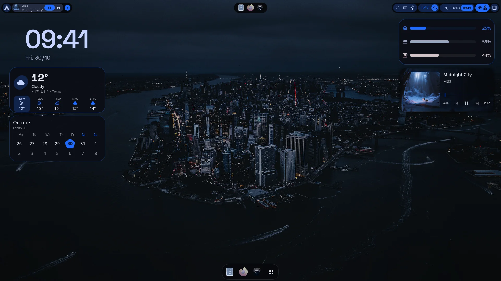
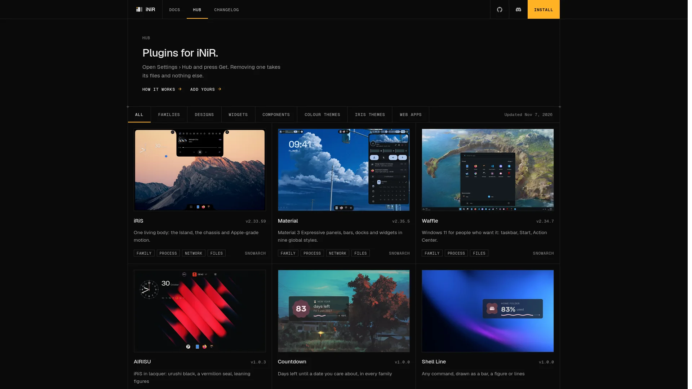
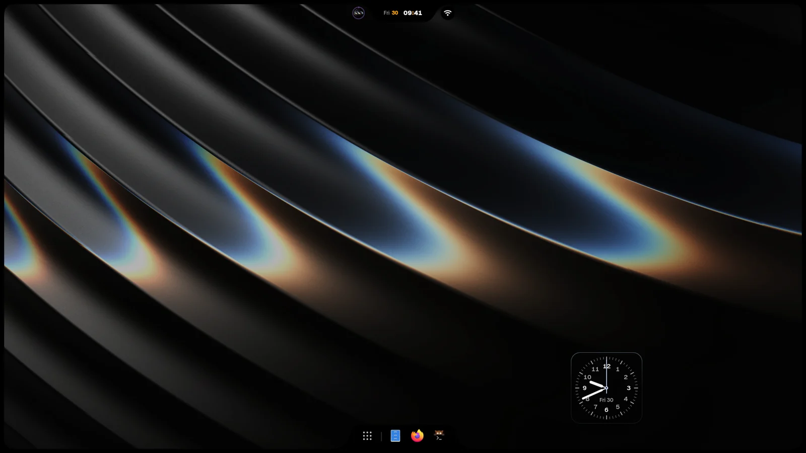

<p align="center">
  
</p>

<h1 align="center">iNiR</h1>

<p align="center">
  A complete desktop shell for <a href="https://github.com/YaLTeR/niri">Niri</a> and <a href="https://github.com/noctalia-dev/umbriel">Umbriel</a>.<br>
  Pick a family, make it yours, keep it current with one command.
</p>

<p align="center">
  <a href="https://github.com/snowarch/iNiR/releases/latest"></a>
  <a href="https://github.com/snowarch/iNiR/stargazers"></a>
  <a href="https://discord.gg/pAPTfAhZUJ"></a>
  <a href="LICENSE"></a>
</p>

<p align="center">
  <a href="https://inir.space">inir.space</a> ·
  <a href="https://inir.space/docs/install/">Install</a> ·
  <a href="https://inir.space/docs">Docs</a> ·
  <a href="https://inir.space/hub">Hub</a> ·
  <a href="https://inir.space/changelog">Changelog</a> ·
  <a href="https://discord.gg/pAPTfAhZUJ">Discord</a>
</p>

<p align="center">
  <sub>
    <a href="README.md">English</a> · <a href="docs/readme/README.es.md">Español</a> · <a href="docs/readme/README.ru.md">Русский</a> · <a href="docs/readme/README.zh.md">中文</a> · <a href="docs/readme/README.ja.md">日本語</a> · <a href="docs/readme/README.pt.md">Português</a> · <a href="docs/readme/README.fr.md">Français</a> · <a href="docs/readme/README.de.md">Deutsch</a> · <a href="docs/readme/README.ko.md">한국어</a> · <a href="docs/readme/README.hi.md">हिन्दी</a> · <a href="docs/readme/README.ar.md">العربية</a> · <a href="docs/readme/README.it.md">Italiano</a>
  </sub>
</p>

> [!NOTE]
> **🍱 Omarchy flavor.** This is a fork of [snowarch/inir](https://github.com/snowarch/inir) for people who live in the **[Omarchy](https://omarchy.org/) ecosystem** but want **iNiR as their shell**. Everything upstream still works — on top you get seamless **Omarchy Hyprland ↔ Niri switching** with a single command, wired into the launcher, the session screen, and an Omarchy bar widget. Omarchy users start here: [🍱 Omarchy users](#-omarchy-users).

---

## What's new in 3.0

A small base with every family as a plugin, a runtime of its own, a home at [inir.space](https://inir.space), and a
new Settings for iRiS. One `inir update` brings it and keeps your config. [Read the whole changelog](CHANGELOG.md).

<table>
<tr>
<td width="50%" valign="top"><br><sub><b>Prism</b><br>iRiS Settings rebuilt: every option in one place, with a live preview of what it changes.</sub></td>
<td width="50%" valign="top"><br><sub><b>The Island</b><br>Music, timers and live activities in one object at the top, in sixteen designs.</sub></td>
</tr>
<tr>
<td width="50%" valign="top"><br><sub><b>AIRISU</b><br>The first Design: its own panels, layout and voice on the iRiS engine.</sub></td>
<td width="50%" valign="top"><br><sub><b>Edit mode</b><br>Drag, resize and save desktop widgets, then switch whole desktops in one click.</sub></td>
</tr>
<tr>
<td width="50%" valign="top"><br><sub><b>Material</b><br>The same widgets in Material's own faces, with its rebuilt Settings and type.</sub></td>
<td width="50%" valign="top"><br><sub><b>iNiR Hub</b><br>Families, Designs, themes and widgets as plugins, at inir.space/hub and inside the shell.</sub></td>
</tr>
</table>

## Families

| Material | Waffle | iRiS |
|:---:|:---:|:---:|
|  |  |  |
| A bar on any edge, sidebars, overview, nine global styles | A Windows 11 taskbar and action center | One Island on any edge that becomes what you open, plus a dock |

`Super+Shift+W` switches between them. More looks, widgets, themes and web apps are in the [hub](https://inir.space/hub).

## Install

```bash
git clone https://github.com/yukazakiri/inir-omarchy.git
cd inir-omarchy
./setup install       # interactive, asks before each step
./setup install -y    # automatic, no questions asked
```

Arch, Fedora, Debian, Ubuntu, Void and NixOS. The [install guide](https://inir.space/docs/install/) has what each one needs. It runs on Niri and on Umbriel: [Compositors](https://inir.space/docs/compositors/) shows how to add Umbriel.

## Update

```bash
inir update
```

Your config and your edits stay. If the new version doesn't start, the update puts back the one you had.

## How it's built

iNiR is a base and the parts around it, each in its own repository. Nothing compiles on your machine: setup and
`inir update` fetch every part prebuilt and check it by sha256.

| Repository | What it is | Latest |
|---|---|---|
| **iNiR** (this one) | The base: services, config, Settings, the welcome wizard, setup and update, the plugin host |  |
| [inir-hub](https://github.com/snowarch/inir-hub) | Every plugin: the three families, components, themes, widgets, web apps | [inir.space/hub](https://inir.space/hub) |
| [qs-rs](https://github.com/snowarch/qs-rs) | The runtime: Quickshell rewritten in Rust, with its own Qt |  |
| [inir-accel](https://github.com/snowarch/inir-accel) | What the shell runs in the background, in Rust: colours, thumbnails, sensors, search |  |
| [inir-cli](https://github.com/snowarch/inir-cli) | The `inir` command: IPC, doctor, update, `inir hub` |  |
| [inir-site](https://github.com/snowarch/inir-site) | [inir.space](https://inir.space): the site, the docs, the hub catalogue | |
| [iNiR-Walls](https://github.com/snowarch/iNiR-Walls), [inir-mascot](https://github.com/snowarch/inir-mascot) | The wallpaper pack and Kira's art, both optional in setup | |

## 🍱 Omarchy users

**Stay on Omarchy. Keep everything. Just change the shell.** This fork is for people who love the Omarchy ecosystem — the curated Arch base, the apps, the theming pipeline, `omarchy` CLI, unattended updates — but want iNiR's shell (Island, pieces, Material You everything, three panel families) instead of the stock Hyprland bar when they run Niri.

Why it works so well together:

- **Two compositors, one system.** Omarchy Hyprland for the classic flow, Niri + iNiR when you want scrollable tiling with a richer shell. Both are uwsm-managed SDDM sessions; your apps, theme, and files are the same on either side.
- **Switching with zero friction.** Omarchy's SDDM autologs in and its greeter has no session picker — so this fork switches the login target itself and logs straight back in. No password prompt, no picker, about two seconds:
  - `Super+Space`, type `/switch`, Enter — flips to Omarchy Hyprland
  - `Super+Shift+Q` session screen → **Omarchy** button
  - On the Hyprland side, the companion [omarchy-niri-switch](https://github.com/yukazakiri/omarchy-niri-switch) bar widget flips you back to Niri the same way
  - Scriptable too: `inir globalActions run switch-to-omarchy`, or `scripts/compositor-switch.sh switch niri`
- **Nothing leaks across the boundary.** iNiR is wired to start only under the Niri session and stop with it — it never haunts your Hyprland bar, and the Omarchy bar never follows you to Niri.
- **Omarchy-safe.** No Omarchy package files are touched. Everything lives in user config (`~/.config/`), one SDDM autologin setting, and two files under `/usr/local/` — so `omarchy update` keeps working exactly as before.
- **Shared-HOME theming isolation.** Both shells use one `$HOME`, so iNiR's external app-theming pipeline stays off here: `appearance.wallpaperTheming.enableAppsAndShell`, `enableQtApps` and `enableTerminal` are all `false` in `~/.config/inir/config.json`, and the pipeline treats that as authoritative (script flag reads are null-safe; `IconThemeService` only applies system-wide when desktop theming is on). iNiR still themes itself; Omarchy's GTK/icon/Qt settings are never rewritten on shell boot or wallpaper change.

Setup is the stock iNiR install plus the Omarchy wiring. On a machine that offers Omarchy's `omarchy-niri.desktop` session, setup wires `inir.service` to the uwsm session unit (`wayland-wm@niri.desktop.service`): the shipped unit names it in its lifecycle, and `inir service enable` (also run by update) creates the wants link. No manual systemd steps. The companion repo bundles the system-side parts into one installer:

```bash
git clone https://github.com/yukazakiri/omarchy-niri-switch.git
cd omarchy-niri-switch
./install.sh   # Niri session + SDDM setter + /switch command + launcher entries
```

---

[Architecture](docs/ARCHITECTURE_OVERVIEW.md) has the whole map. To add something, make it a plugin:
[inir-hub's guide](https://github.com/snowarch/inir-hub/blob/main/CONTRIBUTING.md). To change the base:
[CONTRIBUTING](.github/CONTRIBUTING.md).

## Credits

- [end-4](https://github.com/end-4/dots-hyprland): illogical-impulse, the Hyprland dots iNiR started from
- [Quickshell](https://quickshell.outfoxxed.me/) by outfoxxed: the framework, and the API qs-rs keeps
- [Niri](https://github.com/YaLTeR/niri) by YaLTeR: the compositor
- [Umbriel](https://github.com/noctalia-dev/umbriel) by the Noctalia team: the other compositor iNiR runs on
- [Gakuseei](https://github.com/Gakuseei): [Ricelin](https://github.com/Gakuseei/Ricelin), where the pill bar and the washi and flame look come from
- [pctrade/end4-pC](https://github.com/pctrade/end4-pC): a fork with ideas worth taking
- Everyone who [contributes](https://github.com/snowarch/iNiR/graphs/contributors) and tests on Discord

[GPL-3.0](LICENSE) with the terms in [NOTICE](NOTICE). Copyright (C) 2025-2026 snowarch.
